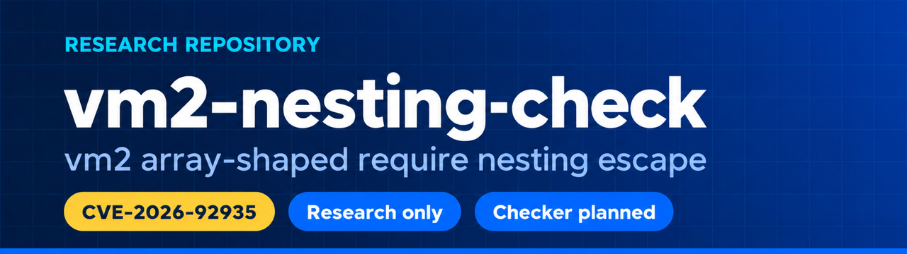
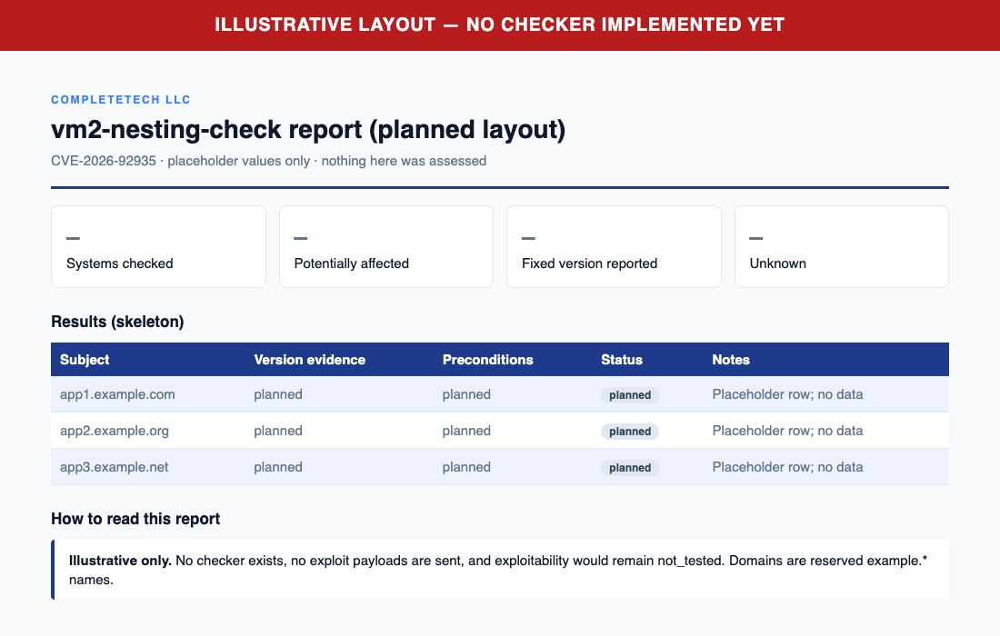

<p align="center">
  
</p>

<p align="center">
  <a href="https://github.com/CompleTetech-Security/vm2-nesting-check/actions"></a>
  
  
  <a href="LICENSING.md"></a>
</p>

# vm2-nesting-check

Offline evidence checker for **CVE-2026-92935: vm2 array-shaped require nesting escape** (alias `GHSA-8hr7-r645-pc6w`).

It compares explicitly supplied vm2 package versions with the reviewed advisory ranges and reports what that version evidence does and does not show. Python 3.10+, standard library only; the single executable `vm2_nesting_check.py` can be copied on its own. It never contacts websites, imports application code, runs a package manager, or executes exploit payloads.

## Contents

- [Scope and honest limits](#scope-and-honest-limits)
- [Requirements](#requirements)
- [Quick start](#quick-start)
- [Synthetic report preview](#synthetic-report-preview)
- [Reviewed rules](#reviewed-rules)
- [Inputs](#inputs)
- [Operator observations](#operator-observations)
- [Source review candidates](#source-review-candidates)
- [Reports and output](#reports-and-output)
- [Exit status and interruption](#exit-status-and-interruption)
- [Limits and data handling](#limits-and-data-handling)
- [Sources and further reading](#sources-and-further-reading)
- [Development and contributing](#development-and-contributing)
- [Security and license](#security-and-license)

## Scope and honest limits

- **Evidence triage only.** A result describes the version (and optional provenance or observations) you supplied. It does not scan deployed systems, test exploitability, or verify that a patch is installed.
- **Inventory comes from you.** A public URL cannot provide installed package inventory. Obtain each deployed package instance's exact version and provenance; declarations and local workstation versions are not deployment evidence.
- **`potentially_affected` is not exploitation.** It means the reported version falls in the documented affected interval. Application preconditions and exploitability were not established, and every row retains `exploitability: not_tested`.
- **`fixed_version_reported` is not a patch attestation.** It only describes a version claim; it never attests installed patches or safety.
- **`unknown` is neither clean nor a failure.** Missing, conflicting, malformed, prerelease, qualified, and custom/vendor builds stay `unknown`, as does anything outside the reviewed ranges.
- **Single-CVE scope.** Versions below 3.11.4 may have other vulnerabilities but are outside this precise advisory.
- Using the checker on real inventories requires authority over those systems. Developing or running this project authorizes no scanning of real targets, and the checker performs none.

## Requirements

- Python 3.10 or newer; no third-party packages.
- Nothing else at runtime. Bounded input and reporting helpers are bundled from the reviewed Node.js checker at `74aa57ba5df05c34d17ae67912cd26ec2335201b`, with package-specific range comparison and the mixed-whitespace CSV fix. No companion repository is needed.
- CI runs the tests on Ubuntu, Windows and macOS with Python 3.10 and 3.14.

## Quick start

```sh
# Assess one reported version and print JSON
python vm2_nesting_check.py --version 3.11.7 --format json

# Assess the example inventory and save an HTML report
python vm2_nesting_check.py --inventory examples/inventory.example.json --format html --output report.html

# Assess a CSV inventory (CSV is the default format) and exit 1 on potentially_affected results
python vm2_nesting_check.py --csv-list inventory.csv --fail-on-finding

# Show every option, then run the local test suite
python vm2_nesting_check.py --help
python -m unittest -v
```

At least one of `--version`, `--inventory`, `--csv-list` or `--source` is required. `--tool-version` prints the checker version (currently 1.1.0).

## Synthetic report preview

<picture>
  <source media="(prefers-color-scheme: dark)" srcset="docs/images/report-dark.png">
  
</picture>

[Open the synthetic example report](docs/example-report.html). Example data only; this is not a live assessment.

## Reviewed rules

Primary advisory and reviewed database retrieved 2026-10-24 (`rules_as_of`).

The documented affected interval is `3.11.4` through `3.11.6`. The reviewed fixed release is `3.11.7`, and the reviewed fixed line is `3.11.x`.

| Example reported version | Result |
| --- | --- |
| 3.11.3 | `unknown` |
| 3.11.4 | `potentially_affected` |
| 3.11.6 | `potentially_affected` |
| 3.11.7 | `fixed_version_reported` |
| 3.11.8 | `fixed_version_reported` |
| 3.12.0 | `unknown` |
| 4.0.0 | `unknown` |

Notes on the boundaries:

- Future lines remain unknown rather than extrapolating a patch claim, and versions outside the exact affected interval remain unknown, including older releases that might have other flaws.
- The database maps this CVE to the canonical GHSA; the maintainer page still shows no known CVE. The report's September 17 date is not the canonical publication date.
- A leading `v` is accepted (`v3.11.7`). Missing, conflicting, malformed, prerelease, qualified, custom/vendor builds remain `unknown`.
- `--build-source` (or the `build_source` field) of blank, `unknown` (the default), `upstream`, `official` or `official_upstream` is compared as upstream. Any other value, such as a vendor name, yields `unknown` because it needs independent patch evidence.

## Inputs

Each input value is a separate package instance; the checker does not reconcile evidence across entries for a single instance. Inputs can be combined in one run.

| Option | Input |
| --- | --- |
| `--version VERSION` (alias `--package-version`) | Reported vm2 version; repeatable. |
| `--inventory FILE` | JSON object or array of objects; repeatable. |
| `--csv-list FILE` | CSV with a header row; repeatable. |
| `--source FILE` | Explicit JS/TS file for lexical review (see [Source review candidates](#source-review-candidates)); repeatable. |
| `--source-root DIR` | Required with `--source`; evidence paths are relative to it. |
| `--build-source SOURCE` | Provenance of the `--version` builds, at most 512 characters. Applies to CLI versions. |
| `--nodevm-nesting-enabled`, `--require-configuration-is-array-shaped`, `--attacker-supplied-javascript-executed` (`true` or `false`) | [Operator observations](#operator-observations) applied to CLI versions. |

**JSON inventory.** One object or an array of objects. Required: integer `schema_version: 1` and string `package_version`. Optional: `package: "vm2"`, `label`, `build_source`, and the observation keys below. Unknown or duplicate keys, wrong types, non-finite numbers and malformed inputs are rejected. See [`examples/inventory.example.json`](examples/inventory.example.json).

```json
{
  "schema_version": 1,
  "package": "vm2",
  "package_version": "3.11.7",
  "label": "example-package-instance",
  "build_source": "unknown",
  "nodevm_nesting_enabled": null,
  "require_configuration_is_array_shaped": null,
  "attacker_supplied_javascript_executed": null
}
```

**CSV list.** The header must include `package_version`. Optional columns are `label`, `build_source`, and the observation keys; observation cells take `true`, `false`, or blank. Other columns are rejected.

```csv
label,package_version,build_source
example-package-instance,3.11.7,unknown
```

## Operator observations

These optional observations map to the advisory's preconditions. Supply them only if you know them. On the command line, replace underscores with hyphens (for example `--nodevm-nesting-enabled true`).

| Observation key | Meaning |
| --- | --- |
| `nodevm_nesting_enabled` | NodeVM nesting enabled |
| `require_configuration_is_array_shaped` | require configuration is array-shaped |
| `attacker_supplied_javascript_executed` | attacker-supplied JavaScript executed |

Each observation is boolean or null (not reported), is unverified, and never changes the package-version result. Absent observations do not establish mitigation. No taint analysis, reachability test or runtime evaluation is performed.

## Source review candidates

Optional source inspection produces separate lexical candidates for NodeVM construction. It is a review aid, not proof of configuration, reachability or attacker control.

```sh
python vm2_nesting_check.py --source examples/source.example.js --source-root examples --format json
python vm2_nesting_check.py --version 3.11.6 --source examples/source.example.js --source-root examples --format html
```

**What it does**

- Select files explicitly with repeatable `--source`; `--source-root` is required and all selected paths must resolve inside it. Nothing is traversed or executed. Accepted extensions are `.js`, `.cjs`, `.mjs`, `.ts`, `.cts`, `.mts`, `.jsx` and `.tsx`.
- The scanner recognizes simple literal `vm2` CommonJS/ES imports, including destructuring aliases and namespace `.NodeVM` construction.
- For each `new` candidate it records the relative path and line, the literal `nesting` value, the array/object or literal `require` shape, and a lexical association to `.run()` on a directly assigned variable.
- A string argument is not proof of trusted input; a variable argument is not proof of attacker control.
- Source rows always have status `unknown`, exploitability `not_tested` and unfilled operator preconditions. They never inherit a separately supplied version's assessment, and they do not trigger the `--fail-on-finding` gate by themselves.

**What it does not do**

- It is a bounded lexical review aid, not an AST or binding/flow analysis. Shadowing, reassignment, execution order, computed imports/options, JSX/TS syntax, templates including interpolation, and regex/division ambiguity need manual review.
- When no supported match is found, the report includes an `unknown` coverage row, never an absence or mitigation verdict.
- Spreads, duplicate or computed keys, dynamic options, and option expressions exceeding 4,096 tokens keep their shapes unknown.
- Source that cannot be tokenized (for example unterminated strings, comments or regexes, or unbalanced delimiters) is an input error, not an assessment.

**Bounds and privacy.** Source shares the 4 MiB/file, 100-file and 10,000-result budgets described under [Limits and data handling](#limits-and-data-handling), with an additional 200,000-token/file limit. Reports contain relative locations and shape labels, without source snippets or source string contents. Selected source files and their aliases remain protected from `--output --force`.

**Schema.** CSV and JSON report schema 1.1 add `source_path`, `source_line`, `source_nesting`, `source_require`, `source_run_argument` and `source_coverage`; HTML includes these candidates in its evidence notes.

## Reports and output

Choose a format with `--format csv|json|html` (default `csv`) and write with `--output FILE`, otherwise the report goes to stdout. JSON, formula-neutralized CSV and escaped script-free HTML share the same assessments. `--brand NAME` sets the organization name in the HTML report (default `CompleteTech LLC`, at most 512 characters).

### Interpreting results

| `status` | Meaning |
| --- | --- |
| `potentially_affected` | Reported version is in the documented affected interval. Not confirmed exploitability. |
| `fixed_version_reported` | Reported version meets the fix within the reviewed `3.11.x` line. A version claim, not installed-patch attestation. |
| `unknown` | Evidence is missing, conflicting, malformed, qualified, vendor-built, outside the reviewed ranges, or comes from source review. Not a clean result. |

A more specific `version_status` accompanies each row: `in_documented_affected_range`, `at_or_above_fixed_version`, `outside_reviewed_range`, `version_not_disclosed`, `unrecognized_or_partial_version`, `qualified_version_unverified`, `vendor_build_unverified`, `conflicting_versions` or `source_discrepancy`. Rows also carry `evidence_type` (`operator_reported_version`, `lexical_source_candidate` or `source_coverage`), `evidence_confidence` (`insufficient` for unknown, otherwise `low`), `exploitability` (always `not_tested`), the three `precondition_*` observations (`reported_true`, `reported_false` or `not_reported`), a recommendation, notes and sources.

### Provenance and metadata

- Every format retains the checker name and version and one UTC ISO-8601 `generated_at` value captured at the start of the run, including interruption recovery. CSV repeats `tool`, `tool_version` and `generated_at` on every result or summary row; JSON retains them in its envelope; HTML displays them in the header and footer.
- `generated_at` describes report generation, not when the supplied inventory was collected or whether a deployment is patched.
- `rules_as_of` is the separate advisory review date, and `report_schema_version` (currently `1.1`) identifies the output contract.
- The JSON envelope contains `tool`, `tool_version`, `report_schema_version`, `cve`, `rules_as_of`, `sources`, `complete`, `generated_at` and `results`.

### CSV rows

- `record_type=result` rows are asset observations.
- A zero-result report has a single `record_type=summary` row carrying provenance, completeness, schema, rule date, CVE and `not_tested`. It is not an asset finding.
- Interrupted result and summary rows keep `report_complete=false`.
- NUL characters are rejected before a report is written.

## Exit status and interruption

| Exit code | Meaning |
| --- | --- |
| `0` | Run completed. |
| `1` | At least one `potentially_affected` result, only with `--fail-on-finding`. `unknown` never counts as a finding-gate failure, and never as a clean result. |
| `2` | Usage, input, output or cleanup failure (an operational error, not an assessment result). This does not establish whether report bytes were already written; inspect the output before retrying. |
| `130` | Interrupted. Completed observations are written with `complete=false` when possible. |

Interruption behavior:

- Interruption during stdout output can leave a truncated document and never appends a second report.
- An interruption after a complete report has been published preserves that report and exits 130.
- If an interrupt leaves file publication indeterminate, the checker exits 130 without retrying. Inspect the output before retrying; the diagnostic does not establish whether publication succeeded.

## Limits and data handling

- Only regular UTF-8 input files are accepted. Limits: 4 MiB per file, 100 input files per run (inventory, CSV and source files combined), 10,000 entries in total, and 512 characters per text field.
- Work from stable copies; these checks are not a filesystem sandbox.
- Output files publish atomically and do not overwrite existing files without `--force`. The output directory must already exist, and inputs remain protected even with `--force`.
- Reports contain operator data. Keep real targets, inventories and reports out of commits; use synthetic evidence in tests and examples.

## Sources and further reading

Primary advisory sources:

- <https://github.com/patriksimek/vm2/security/advisories/GHSA-8hr7-r645-pc6w>
- <https://github.com/advisories/GHSA-8hr7-r645-pc6w>

Repository documents:

- [Synthetic example report](docs/example-report.html)
- [Detailed reference](docs/REFERENCE.md)
- [Implementation status](docs/IMPLEMENTATION.md)
- [Repository instructions (AGENTS.md)](AGENTS.md)
- [Brand assets](BRAND_ASSETS.md)

## Development and contributing

Before proposing a change, read [AGENTS.md](AGENTS.md) and [CONTRIBUTING.md](CONTRIBUTING.md), then run:

```sh
python -m unittest -v
python vm2_nesting_check.py --help
git diff --check
```

Use synthetic evidence only, verify primary sources before changing ranges, and never run application code or send exploit payloads. Local results are not hosted CI results; review and exact-head hosted CI precede merge.

## Security and license

- Report flaws in this project as described in the [security policy](SECURITY.md).
- Code is available under [AGPL-3.0](LICENSE) or a separate commercial license from CompleteTech LLC; see [LICENSING.md](LICENSING.md).
- CompleteTech LLC names, logos and the artwork in `docs/images/` are brand assets, not covered by the code license; see [BRAND_ASSETS.md](BRAND_ASSETS.md).
- Contribution terms are in [CONTRIBUTING.md](CONTRIBUTING.md#licensing-of-contributions).
